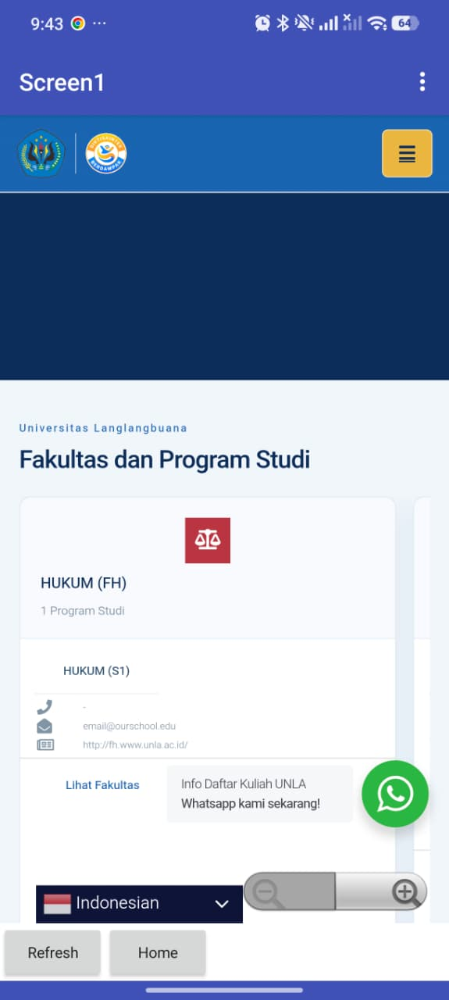
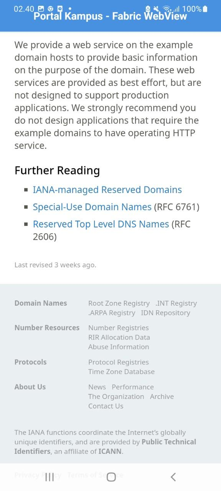

# Portal Kampus WebView (Prototyping 2 Siklus)

Proyek ini menampilkan website kampus di dalam aplikasi Android menggunakan komponen WebView. Pengembangannya memakai metode **prototyping** yang dikerjakan dalam dua siklus: siklus pertama membuat prototype awal dengan MIT App Inventor, lalu siklus kedua membangun ulang aplikasinya dengan React Native. Proyek ini dibuat sebagai bagian dari tugas dan UTS mata kuliah Pemrograman Mobile.

## Metode Pengembangan: Prototyping

Prototyping dipilih karena aplikasi dibuat bertahap: buat prototype, lihat hasilnya, evaluasi, lalu perbaiki di siklus berikutnya.

| Siklus | Sesi | Tools | Tujuan |
|--------|------|-------|--------|
| 1 (Prototype awal) | Sesi #2 | MIT App Inventor | Membuat prototype WebView dengan cepat untuk menampilkan website kampus |
| 2 (Pengembangan lanjutan) | Sesi #3 | React Native | Membangun ulang aplikasi dengan kode yang bisa dikelola lewat GitHub |

## Siklus 1: Prototype Awal (MIT App Inventor)

Pada siklus ini dibuat aplikasi sederhana yang membuka website kampus (UNLA) lewat WebView. Terdapat dua tombol di bagian bawah, yaitu **Refresh** untuk memuat ulang halaman dan **Home** untuk kembali ke halaman awal. Siklus ini dikerjakan secara berkelompok.



**Unduh APK:** [Google Drive](https://drive.google.com/file/d/11hy6AcK6GtYDPkcmPFSXbNiRqeZxBhHV/view?usp=sharing)

**Evaluasi siklus 1:**
- Judul aplikasi masih memakai nama bawaan "Screen1"
- Fitur masih terbatas pada tombol Refresh dan Home
- Aplikasi hanya dibagikan dalam bentuk APK, sehingga kodenya tidak bisa dikelola di GitHub

## Siklus 2: Pengembangan dengan React Native

Berdasarkan evaluasi siklus 1, aplikasi dibangun ulang menggunakan React Native dengan judul **"Portal Kampus - Fabric WebView"**. Siklus ini dikerjakan secara individu.



**Perbaikan dibanding siklus 1:**
- Judul aplikasi sudah diganti dan lebih sesuai dengan fungsinya
- Source code tersimpan di GitHub sehingga mudah dikelola dan dikembangkan
- Struktur aplikasi lebih fleksibel untuk ditambah fitur baru

**Yang masih bisa dikembangkan:**
- Menambahkan tombol Refresh dan Home seperti pada siklus 1
- Menambahkan indikator loading saat halaman dimuat
- Mengarahkan WebView ke alamat website kampus

## Fitur Utama

- Menampilkan halaman web di dalam aplikasi (WebView)
- Judul aplikasi sesuai tema "Portal Kampus"
- Pada prototype awal: tombol Refresh dan Home

## Teknologi yang Digunakan

- MIT App Inventor (siklus 1)
- React Native dengan komponen WebView (siklus 2)
- Node.js dan npm

## Cara Menjalankan

**Siklus 1:** unduh APK lewat link Drive di atas, lalu install di HP Android (izinkan instalasi dari sumber tidak dikenal).

**Siklus 2:**

1. Pastikan Node.js dan Android Studio (atau HP Android dengan USB debugging) sudah siap.
2. Clone repositori ini:

   ```bash
   git clone https://github.com/fasha09/webview-prototyping.git
   cd webview-prototyping
   ```

3. Install dependencies:

   ```bash
   npm install
   ```

4. Jalankan Metro, lalu di terminal lain jalankan aplikasi:

   ```bash
   npm start
   npm run android
   ```

## Kontak

- GitHub: [fasha09](https://github.com/fasha09)
